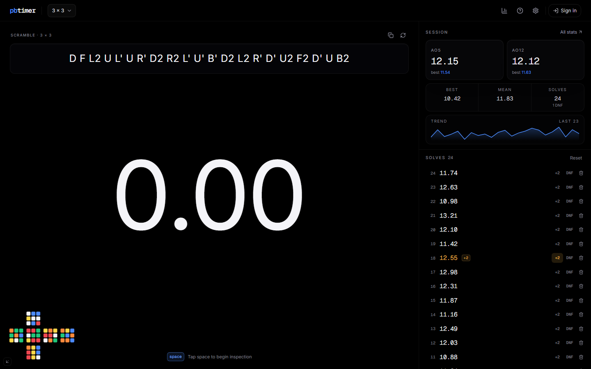

# pbtimer

A quiet, precise speedcubing timer. WCA scrambles, 15-second inspection, real averages and session stats — all saved in your browser, no account required.

[**Live demo →**](https://example.com)



## Features

- **12 WCA events** — 2×2 through 7×7, one-handed, blindfolded, Pyraminx, Skewb, Megaminx and Square-1.
- **Hold-to-arm start** — hold, wait for green, release. Stray keypresses can't start a solve.
- **WCA inspection** — 15-second countdown with automatic +2 at 15s and DNF at 17s.
- **Proper averages** — current, best and worst ao5 / ao12 / ao50 / ao100 using WCA trimming rules.
- **Session insights** — best and worst single, mean, standard deviation, DNF rate and a trend chart.
- **Cube state preview** — a 2D net shows the scramble applied to a solved cube (2×2, 3×3).
- **Full solve history** — every solve stores its scramble; apply +2 / DNF or delete in one click.
- **Keyboard-first** — space to time, `N` for a new scramble, `2` / `D` for penalties, `Del` to remove.
- **Export and backup** — readable text log, JSON backup and import that merges without duplicates.
- **Optional sync** — sign in to keep devices in step via Supabase; everything still works offline.

## Tech Stack

React 19 · TypeScript · Vite 6 · Tailwind CSS v4 · cubing.js (scrambles) · Supabase (optional auth & sync) · lucide-react

## Getting Started

### Prerequisites

- Node.js 20 or newer
- npm

### Installation

```bash
git clone https://github.com/imVansh2010/pbtimer.git
cd pbtimer
npm install
npm run dev
```

Open [http://localhost:5173](http://localhost:5173).

### Optional: account sync

The timer runs fully local by default. To enable sign-in and multi-device sync, add your Supabase credentials:

```bash
cp .env.example .env.local
```

Set `VITE_SUPABASE_URL` and `VITE_SUPABASE_ANON_KEY` in `.env.local`, then apply the schema in [`supabase/migrations`](supabase/migrations). Setup details are in [`supabase/README.md`](supabase/README.md).

### Production build

```bash
npm run build
npm run preview
```

## Usage

Hold <kbd>space</kbd> — or press and hold the timer — until the digits turn green, then release to start. Any press stops the timer. With inspection enabled, the countdown runs first.

| Key     | Action                                       |
| ------- | -------------------------------------------- |
| `space` | Hold to arm, release to start, press to stop |
| `N`     | New scramble                                 |
| `2`     | Mark last solve +2                           |
| `D`     | Mark last solve DNF                          |
| `Del`   | Delete last solve                            |
| `Esc`   | Cancel inspection or close a dialog          |

## Development

```bash
npm run check   # typecheck, lint and formatting
```

## License

MIT
